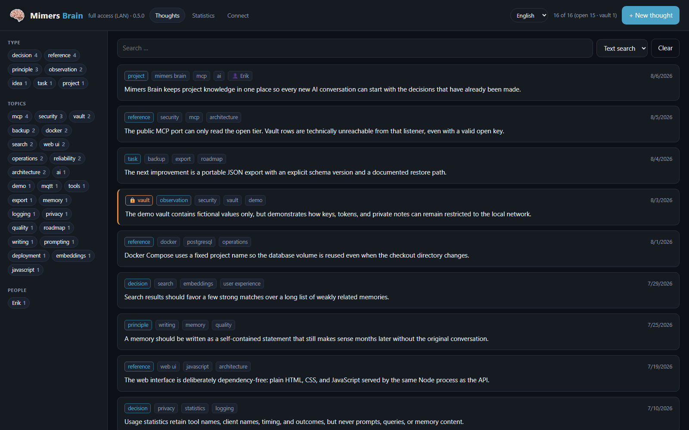
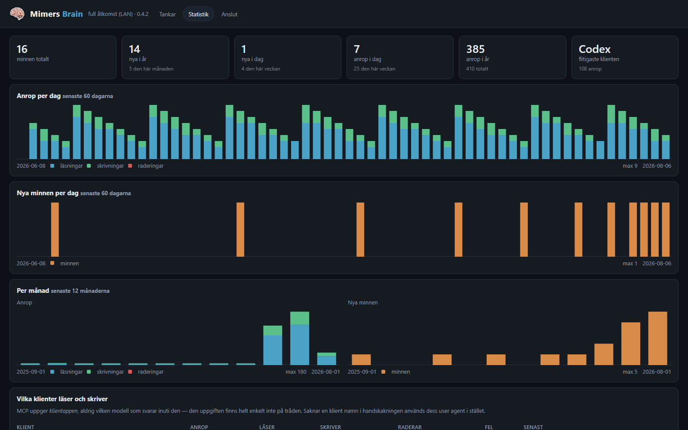

# Mimers Brain

*[English](README.md)*

Ett självhostat långtidsminne för språkmodeller. Samma idé som
[OB1](https://github.com/NateBJones-Projects/OB1), och byggt på samma sätt:
PostgreSQL med [pgvector](https://github.com/pgvector/pgvector), där varje minne
sparas med en embedding och hittas med semantisk sökning. Skillnaden är att det
körs på egen hårdvara, med en nivå som aldrig lämnar det lokala nätverket.

Alla klienter som talar MCP (eller OpenAPI) kan söka i och skriva till minnet. Det
du vet om dina system skrivs ner en gång i stället för att förklaras om i varje
konversation.



## Så fungerar det, kort

1. **Ett minne är en rad.** Tabellen `thoughts` kommer från OB1, plus kolumnen
   `tier`. Varje rad har texten, strukturerad metadata och en embedding: en
   vektor som beskriver vad texten betyder.
2. **Skrivning.** Vid varje skrivning vägrar servern text som ser ut som en
   hemlighet, ber en metadatamodell om titel, sammanfattning, sort, projekt,
   ämnen och system, och ber en inbäddningsmodell om vektorn. Ett fingeravtryck
   av texten gör att en exakt kopia uppdaterar den befintliga raden i stället
   för att lägga till en ny.
3. **Sökningen är semantisk.** Frågan får också en vektor, och pgvector hittar
   de närmaste minnena med cosinuslikhet via ett HNSW-index. Rangordningen är
   hybrid: mest betydelse (0,80), plus fritextträffar i titel, sammanfattning
   och text, och minnets granskningsstatus. En fråga kan hitta ett minne som
   inte delar ett enda ord med den.
4. **Kvitton.** Varje sökning ger ett `trace_id`, och klienten rapporterar vilka
   träffar den använde. Minnen som används ofta stiger i rangordningen; de som
   aldrig används listas för granskning.

Detaljer: [docs/how-it-works.md](docs/how-it-works.md) (engelska).

## Vad det gör

- **Två nivåer.** *Öppen* kunskap nås var som helst via en reverse proxy.
  *Valvet* — känslig kontext och `SECRET_REF`-pekare — finns bara på LAN. Nivån
  avgörs av porten, aldrig av en header.
- **En spärr mot hemligheter.** Råa lösenord, tokens, API-nycklar och privata
  nycklar vägras vid varje skrivning, innan texten når en modell,
  inbäddningen eller databasen.
- **Styrt minne.** Minnen som en agent skriver börjar som väntande underlag, inte
  instruktioner, tills du bekräftar dem. En rättelse ersätter det gamla minnet
  och behåller det som historik i stället för att radera det.
- **Lång text i delar.** En lång källa delas upp i förslag på atomära minnen, och
  bara de du godkänner sparas.
- **Ett startpaket.** `memory_digest` ger varje klient användarpolicyn och dina
  bekräftade regler en gång per session, vilken klient det än är.
- **Minnen vid frågan.** En [Claude Code-hook](tools/hooks/README.md) söker vid
  varje fråga och lägger till upp till tre tydliga träffar i modellens kontext.
- **Motsägelser och dubbletter.** En kontroll varje natt låter en modell avgöra om
  par av liknande minnen säger emot varandra. Nästan likadana minnen listas
  också. Du avgör varje par på sidan Granska, eller tillsammans med en modell via
  MCP-verktygen.
- **En ändringslogg.** En trigger i databasen sparar varje skapande, ändring och
  radering, även från psql. Varje version kan återställas, och ett raderat minne
  kan återställas i 30 dagar.
- **Välj dina modeller.** Inbäddning, metadata och motsägelsekontrollen har var
  sin leverantör och modell: OpenRouter, OpenAI, Ollama eller en valfri
  OpenAI-kompatibel server. En lokal inbäddningsmodell som `bge-m3` i Ollama
  fungerar, och ett byte av inbäddningsmodell indexerar om i bakgrunden före
  bytet.
- **Mätt, inte gissat.** Dina egna frågor mäter recall och föreslår likhetsgränser
  för varje inbäddningsmodell. Fall med kända svar testar en motsägelsemodell
  innan den tas i bruk.
- **Home Assistant.** Valfria MQTT-sensorer publicerar antal och hälsa, aldrig
  innehåll. Se [docs/home-assistant.md](docs/home-assistant.md) (engelska).
- **Webbgränssnitt** på svenska och engelska, mörkt eller ljust, för att bläddra,
  redigera, granska, se statistik och ansluta klienter.

## Teknik

Node.js (inget webbramverk), MCP TypeScript SDK och `zod`, PostgreSQL 17 med
pgvector i imagen `pgvector/pgvector:pg17`, och Docker Compose. Webbgränssnittet
är vanlig HTML och ES-moduler utan byggsteg.

| Sökväg | Innehåll |
| --- | --- |
| `db/init.sql` | Schema: tabeller, pgvector och HNSW-index, upsert med fingeravtryck, trigger för ändringsloggen |
| `server/index.mjs` | HTTP-lyssnare på tre portar, autentisering, webb-API, nattligt underhåll |
| `server/mcp.mjs`, `server/openapi.mjs` | MCP-verktygen och samma verktyg som REST |
| `server/lib.mjs` | Databasåtkomst, sökning och rangordning, relationer, motsägelser, dubbletter |
| `server/memory-model.mjs` | Regler för metadata, användarpolicyn och vägledning för verktygen |
| `server/ai.mjs`, `server/model-settings.mjs` | Leverantörer, modeller, inbäddningar och omindexering |
| `server/secret-gate.mjs` | Kontrollen som vägrar hemligheter |
| `server/public/` | Webbgränssnittet |
| `server/test/` | Tester (`npm test`) |

## Dokumentation

| | |
| --- | --- |
| **[install.sv.md](install.sv.md)** | Installation på Proxmox LXC, Docker Desktop eller Ubuntu Server: konfiguration, reverse proxy, backup, uppdatering, lokal inbäddningsmodell, test av motsägelser |
| **[HowToUse.sv.md](HowToUse.sv.md)** | Ansluta Claude Code, Codex, Claude Desktop, ChatGPT, Open WebUI; vad som hör hemma i minnet |
| **[docs/how-it-works.md](docs/how-it-works.md)** | Nivågränsen, autentisering, minnesmodellen, sökning, modeller, underhåll (engelska) |
| **[docs/home-assistant.md](docs/home-assistant.md)** | MQTT-sensorer för Home Assistant (engelska) |
| **[tools/hooks/](tools/hooks/README.md)** | Claude Code-hook som lägger relevanta minnen vid varje fråga |
| **[docs/nginx-brain.conf](docs/nginx-brain.conf)** | Mall för reverse proxy |
| **[docs/translations.md](docs/translations.md)** | Lägga till ett språk i gränssnittet |
| **[migrate/](migrate/README.md)** | Engångsimport av befintliga anteckningar |
| **[history.sv.md](history.sv.md)** | Vad som byggts, varför, och vad som gick fel |

> **Adresserna i dokumentationen är platshållare.** `192.0.2.x`
> ([RFC 5737](https://www.rfc-editor.org/rfc/rfc5737)) och `example.net`
> ([RFC 2606](https://www.rfc-editor.org/rfc/rfc2606)) pekar ingenstans. Byt mot
> dina egna och spara de riktiga värdena i `docs/deployment.local.md`
> (gitignorerad).

## Snabbstart

Kräver Docker med Compose. Fullständiga instruktioner: [install.sv.md](install.sv.md).

```bash
git clone https://github.com/Snille/Mimers-Brain.git && cd Mimers-Brain
cp .env.example .env    # sätt POSTGRES_PASSWORD, MCP_ACCESS_KEY, OPENROUTER_API_KEY, CITATION_BASE_URL
docker compose up -d --build
```

Öppna <http://localhost:8790>, logga in med `MCP_ACCESS_KEY` och gå till
**Anslut**: där finns färdiga inställningar att kopiera för varje klient, ifyllda
med den här instansens adresser och nycklar. För Claude Code på LAN:

```bash
claude mcp add --transport http mimers-brain http://192.0.2.41:8790/mcp --header "Authorization: Bearer <MCP_ACCESS_KEY>"
```

Standardmodellerna körs på OpenRouter. I stället för `OPENROUTER_API_KEY` kan du
ställa in valfri leverantör på sidan **Inställningar**. Utan en leverantör för
inbäddning får inget en vektor, och bara listning och textsökning fungerar.

## Tre portar

| Port | Innehåll | Vem får nå den |
| --- | --- | --- |
| **8790** | öppet + valv, webbgränssnitt, alla verktyg | bara LAN/VPN. **Proxa den aldrig.** |
| **8791** | öppen nivå, webbgränssnitt | den enda port en publik reverse proxy pekar på |
| **8792** | öppen nivå, bara läsverktyg, inget gränssnitt | en modell som får slå upp men inte skriva |

Den öppna och den läsande lyssnaren byggs utan möjlighet att nå valvrader, så
ingen parameter, header eller sökväg ändrar vad de svarar. Se
[docs/how-it-works.md](docs/how-it-works.md#the-tier-boundary).

## MCP-verktyg

| Verktyg | 8790 | 8791 | 8792 |
| --- | :-: | :-: | :-: |
| `memory_digest` — användarpolicy och stående regler; anropas en gång per session | ✓ | ✓ | ✓ |
| `search_thoughts` — semantisk sökning | ✓ | ✓ | ✓ |
| `list_thoughts`, `thought_stats` | ✓ | ✓ | ✓ |
| `search` + `fetch` — paret ChatGPT förväntar sig | ✓ | ✓ | ✓ |
| `report_memory_usage` — kvitto för en sökning | ✓ | ✓ | ✓ |
| `capture_thought`, `preview_ingest` + `apply_ingest` | ✓ | ✓ | |
| `supersede_thought`, `review_memory`, `delete_thought` | ✓ | | |
| `list_contradictions` + `dismiss_contradiction` — gå igenom Granska-sidans möjliga motsägelser | ✓ | | |
| `list_duplicates` + `resolve_duplicate` — gå igenom Granska-sidans möjliga dubbletter | ✓ | | |

Det är 17 verktyg på 8790, 10 på 8791 och 7 på 8792. Samma verktyg finns som REST
för OpenAPI-klienter: `GET /openapi.json` och `POST /tools/<namn>` (med
`fetch_thought` i stället för `search`/`fetch`).

## Webbgränssnittet

| Sida | Till för |
| --- | --- |
| **Tankar** | Lista, hybridsökning, filter, granskning av nya agentminnen med hela texten, redigering (på 8790 även flytt av ett minne mellan öppen nivå och valvet), ändringshistorik med återställning, *Kopiera referens* till en chatt, fästa minnen i startpaketet (`memory_digest`) |
| **Granska** | Hur många minnen som väntar på granskning (med länk till dem under Tankar), dubbletter, möjliga motsägelser, sällan till nytta, nyligen raderade |
| **Statistik** | En 3D-karta över minnet (kan stängas av), hälsa, hur användbara hämtade minnen är, klientaktivitet, MQTT-status, hur länge kvitton sparas |
| **Anslut** | Inställningar för varje klient |
| **Inställningar** | Bara port 8790: tema och accentfärg, leverantörer och nycklar, modeller, omindexering, de fyra likhetsgränserna och mätningarna av recall och motsägelser |

Gränssnittet finns på 8790 (logga in med `MCP_ACCESS_KEY`) och 8791 (öppen nivå,
bakom din autentisering). Texterna laddas från JSON-kataloger, webbläsarens språk
väljs första gången och ett manuellt val sparas.



## Utveckling

```bash
cd server
npm ci
npm test          # databastesterna hoppas över utan TEST_DATABASE_URL
npm run audit     # läsande kvalitetsrapport över databasen i DATABASE_URL
```

Databastesterna behöver en tillfällig Postgres med pgvector; se början av
`server/testing/db.mjs`. En ny miljövariabel ska läggas i `.env.example` och
skickas under `app.environment` i `docker-compose.yml`. Ett nytt MCP-verktyg ska
in i både `server/mcp.mjs` och `server/openapi.mjs`.

Compose-projektet, containrarna och volymen behåller sina gamla `valv`-namn med
flit; att byta namn skulle starta en tom databas. Se
[docs/how-it-works.md](docs/how-it-works.md#naming).
