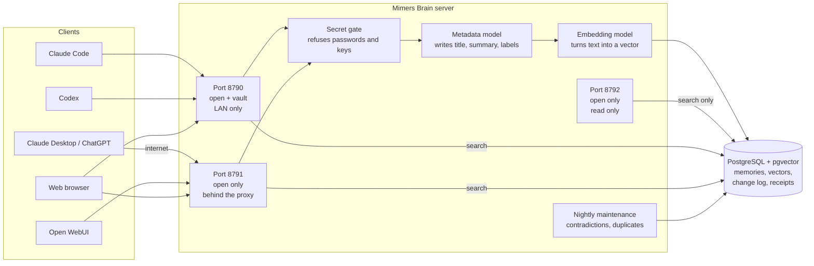
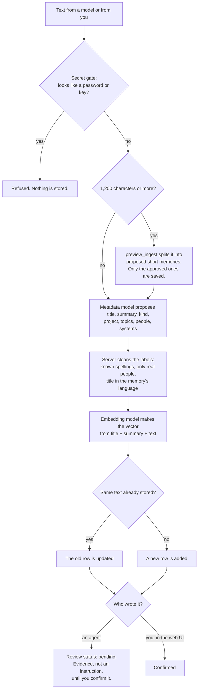
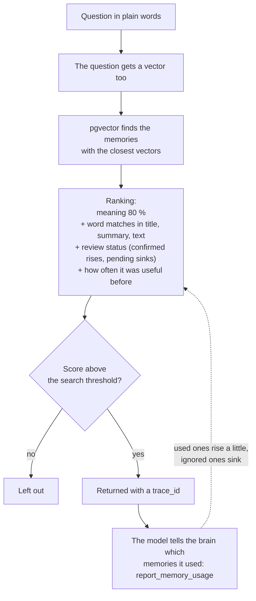
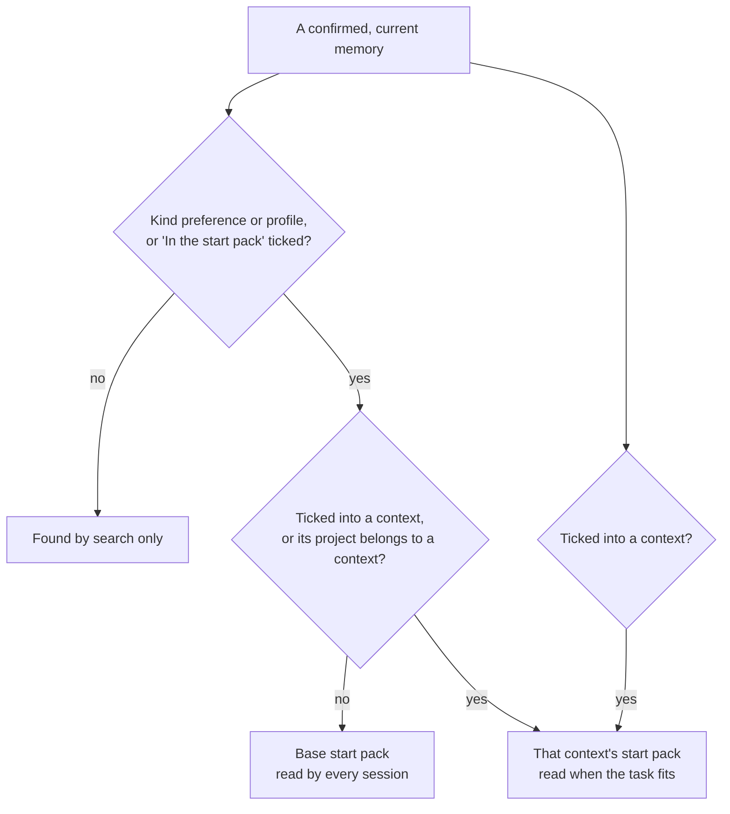
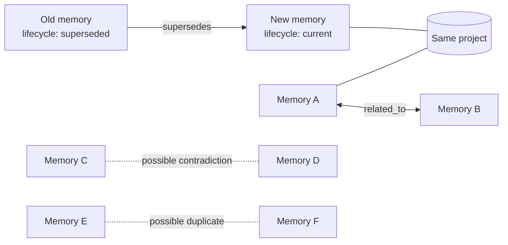

# Concepts: the parts, the fields, and what affects what

*[Svenska](concepts.sv.md)*

A guide for someone meeting Mimers Brain for the first time. It explains what
the parts are, how they connect, and what every field in the memory editor
means. How to install is in [install.md](../install.md), how to connect a client
in [HowToUse.md](../HowToUse.md), and the deeper design in
[how-it-works.md](how-it-works.md).

## In one paragraph

Mimers Brain is a notebook that language models read and write. Each note is a
**memory**: a short text that stands on its own, plus labels that say what it is
about. A model asks the brain a question in plain words. The brain finds the
memories that *mean* the same thing, even with different words, and returns
them. So the model knows about your systems without you explaining them again
in every chat.

## The big picture

| Part | What it does |
| --- | --- |
| **Client** | A program with a language model in it: Claude Code, Codex, a chat app. It talks to the brain over MCP (or OpenAPI). |
| **MCP** | *Model Context Protocol.* The standard way a model calls tools. The brain offers tools such as `search_thoughts` and `capture_thought`. |
| **Port / listener** | The brain answers on three doors. Which door you use decides what you can reach. 8790 reaches everything and must stay on the home network. 8791 reaches only open memories and is the one the internet may see. 8792 is 8791 without any tool that writes. |
| **Secret gate** | Checks every text before anything else sees it. Text that looks like a password, token or key is refused. |
| **Metadata model** | A language model that reads a new memory and proposes its title, summary, kind, project, topics, people and systems. |
| **Embedding model** | A model that turns text into a **vector**: a long list of numbers that describes what the text means. Texts with similar meaning get similar vectors. |
| **Database** | PostgreSQL with the pgvector add-on. One row per memory. It also keeps every change, so any version can be restored. |
| **Nightly maintenance** | Once a day, a model compares pairs of similar memories and lists the ones that may contradict each other or are near copies. It changes nothing on its own. |
| **Web UI** | The pages *Memories*, *Review*, *Statistics*, *Connect* and *Settings*. Settings opens only on port 8790. |

## What happens when a memory is saved

## What happens when a model searches

Only **title, summary and text** go into the vector. The labels (project,
topics, people, systems) do **not** change what a search finds by meaning. They
are for filtering and for overview. See [What affects what](#what-affects-what).

## The start pack (`memory_digest`) and contexts

A model calls `memory_digest` once at the start of a session. It gets the usage
policy and the memories that it should know before it does anything. That is the
**start pack**.

A **context** is a start pack for one kind of work, for example *Spectrogon*
(work) or *Personal*. When a model's task fits a context, it asks for that
context too. Those memories win where they differ from the base pack. Contexts
are set up under **Settings → Contexts**.

- Only **confirmed** memories reach a start pack. A memory an agent wrote waits
  until you confirm it on the *Review* page or the *Memories* page.
- The base pack holds at most 15 memories or 9,000 characters; a context holds 10
  memories or 6,000 characters. The *Memories* page says when something does not
  fit.
- Pin only what a model would get wrong without, in many different tasks.
  Everything else is found by search.
- An agent cannot pin a memory or put it in a context. Only you can, because a
  start pack is read as your instruction.

## The fields in the editor

The editor on the *Memories* page shows these fields. The chips at the top are
a summary of the same fields: kind (green), project (📁), topics (plain) and
systems (⚙). The date is when the memory was written; the long code under it is
its **GUID**, the memory's permanent id.

The example below is a real memory: *"Mimers Brain: fix a title or summary in
the wrong language with resummarise.mjs"*.

| Field | What it means | Who fills it | What it affects |
| --- | --- | --- | --- |
| **Text** (*Content*) | The memory itself. One claim that is understandable years later without the chat around it. Under 1,200 characters. | The writer | Search by meaning and by words. This is what a model reads. |
| **Title** | A short name, in the same language as the text. | Metadata model; you can change it | Search by meaning, and word matches in the title count extra. Shown in every list. |
| **Summary** | One or two sentences. Search results show it instead of the whole text. | Metadata model; you can change it | Search by meaning and by words. |
| **Kind** | What sort of knowledge it is. See the table below. | Metadata model; you can change it | `preference` and `profile` go into the start pack. `task` has a task status. `incident` never gets an age warning. Filter. |
| **Lifecycle** | `current`: valid now, search finds it. `superseded`: replaced by a newer memory, kept as history. `archived`: no longer needed, kept, but search does not find it. | `current` by default; `superseded` is set by a correction | Whether search and the start pack see it at all. |
| **Task status** | `pending` or `done`. Only for kind `task`. | The writer | Filter. Lets a model find what is left to do. |
| **Project** | The **one** repository or service that owns this knowledge. Example: `mimers-brain`. Never the client that wrote it. | Metadata model; you can change it | Filter in search and lists. A context can claim a project: then that project's standing memories go into the context's start pack. |
| **Topics** | **Several** broad subjects, for browsing. Example: `mimers-brain, backup`. There is a settled list (network, docker, security, home-assistant …); known synonyms land on its spelling, but any text is allowed. | Metadata model; you can change them | Filter and overview only. |
| **People** | Humans the memory is about. Only real people: a name is kept only if it is a known person or written in the text. | Metadata model; you can change them | Filter only. |
| **Systems** | Named technical things: programs, containers, scripts, devices, accounts. Example: `Mimers Brain, valv-app, resummarise.mjs, backup.sh`. | Metadata model; you can change them | Filter only. |
| **Verified date** | The day someone last checked that it is still true. | You or a model | After 180 days without a check (counted from this date, else from when it was written), a model is told the memory *may be outdated*. |
| **Tier** | `open`: readable outside the home network too. `vault`: readable only on the LAN, for sensitive context and `SECRET_REF` pointers. Never a raw secret in either. | Writer; you can move it on port 8790 | Which ports can see it. |
| **In the start pack** | Pins the memory into the start pack. Preferences and profiles are in by default; untick to take them out. | Only you | Whether every session reads it first. |
| **Contexts** | Ticks the memory into one or more contexts' start packs instead of the base. | Only you | Which start pack it is in. |
| **Media** | Links to a person, album or picture on Immich, or to any web page. The brain keeps only the link. | You | A model can fetch the pictures with `get_media`. The card shows thumbnails. |

Some fields do not show in the editor but steer how a memory is trusted:
**review status** (pending, confirmed, evidence only, stale, rejected),
**origin** (user, agent, import …) and **captured by** (which client wrote it). You set
the review status on the *Review* page or on the card.

### Kinds

| Kind | Use it for |
| --- | --- |
| `fact` | Something true about how a thing is. |
| `reference` | Where something is: a path, an address, a link. |
| `procedure` | How to do something, step by step. |
| `decision` | A choice that was made, and why. |
| `lesson` | Something learned, so the mistake is not made again. |
| `incident` | What happened when something broke, and the conclusion. |
| `task` | Something still to do, with a concrete next step. |
| `idea` | A possible future change. Not decided. |
| `preference` | How the user wants things done. In the start pack. |
| `profile` | Facts about the user as a person. In the start pack. |

### Project, topics, systems and people: the difference

They answer four different questions:

| Field | Question | How many | Example |
| --- | --- | --- | --- |
| **Project** | *Whose knowledge is this?* | One | `mimers-brain` |
| **Topics** | *What is it about, broadly?* | A few | `mimers-brain`, `backup` |
| **Systems** | *Which named things does it mention?* | Any | `valv-app`, `resummarise.mjs`, `backup.sh` |
| **People** | *Which humans is it about?* | Any | `Erik` |

A good rule: **project** is the folder it would live in; **topics** are the
shelf labels; **systems** are the nouns you could point at; **people** are only
humans. One name can mean different things: *Snille* in people is a person, in
systems it is a GitHub account.

## How memories connect to each other

Memories are not only alone. The brain links them:

- **Supersedes.** A correction (`supersede_thought`) writes a new memory and
  marks the old one superseded. The old one stays as history and points to its
  replacement. Pins and media move to the new one.
- **Related.** When you decide two near-copies should both stay, you can link
  them as related.
- **Possible contradiction.** The nightly check lists pairs of similar memories
  that may say opposite things. You decide on the *Review* page: dismiss, or fix
  the wrong one with a correction.
- **Possible duplicate.** Pairs that are almost the same text. You keep both,
  link them, or merge them.
- **Same project / topic / system.** Not a link as such, but the filters on the
  *Memories* page show every memory that shares the label.

## What affects what

| When you change … | … this happens |
| --- | --- |
| Text, title or summary | The memory gets a new vector, so search by meaning changes. The change log keeps the old version. |
| Project, topics, people or systems | Filters change. Search by meaning does **not** change. A new project can move the memory into or out of a context. |
| Kind to `preference` or `profile` | It joins the start pack (once confirmed), unless you untick *In the start pack*. |
| Lifecycle to `archived` | Search and the start pack stop seeing it. It is still stored. |
| Tier to `vault` | Ports 8791 and 8792, and every cloud chat, stop seeing it. |
| Tier to `open` | It becomes readable from outside the home network. The editor asks first. |
| Verified date | Resets the 180-day age warning. |
| Review status to confirmed | It ranks a little higher, can be read as an instruction, and can enter a start pack. |
| The embedding model (Settings) | Every memory gets a new vector in the background. The search thresholds belong to the model, so they change with it. |
| A context's projects (Settings) | Standing memories of those projects move from the base start pack to that context. |

## Words used in the brain

| Word | Meaning |
| --- | --- |
| **Memory** (*thought* in tool names) | One stored text with its labels. |
| **Vector / embedding** | Numbers that describe the meaning of a text. Close vectors mean similar meaning. |
| **Similarity** | How close two vectors are, from 0 to 1. Shown as a percentage in search results. |
| **Threshold** | The lowest similarity that counts. There are four: search, recall hook, contradiction and duplicate. Each embedding model has its own. |
| **Tier** | Open or vault. Decided by the port, never by what the client says. |
| **Vault** | The part of the brain only the home network can reach. |
| **`SECRET_REF`** | A pointer that says *where* a secret is kept, never the secret. |
| **Start pack / digest** | What a model reads once at the start of a session. |
| **Context** | A start pack for one kind of work. |
| **Receipt / trace** | After a search, the model reports which results it used. It stores ids only, never the question. |
| **Agent** | A model that writes on its own. Its memories wait for your review. |
| **Recall hook** | A Claude Code add-on that searches the brain for every prompt and adds up to three clear hits. See [tools/hooks](../tools/hooks/README.md). |
| **Ingest** | Splitting a long text into short memories that you approve one by one. |
