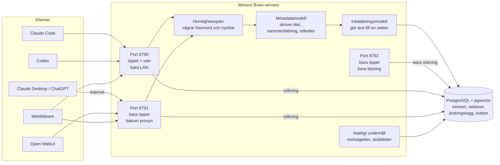
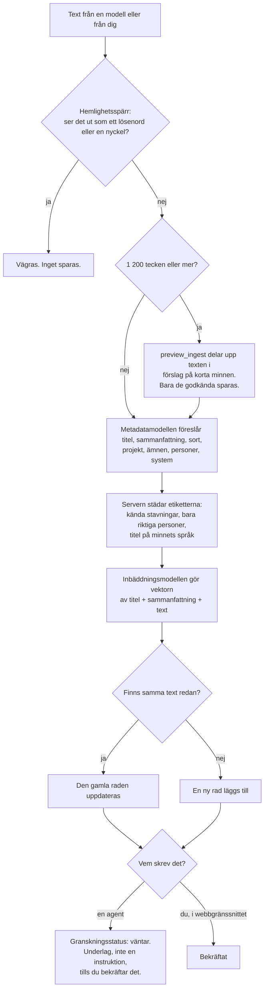
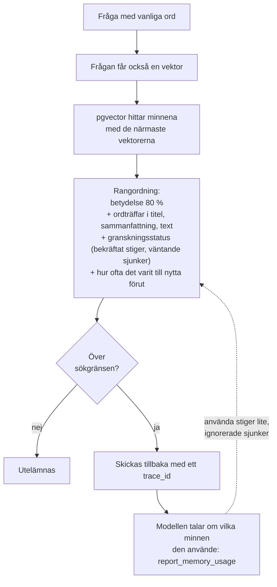
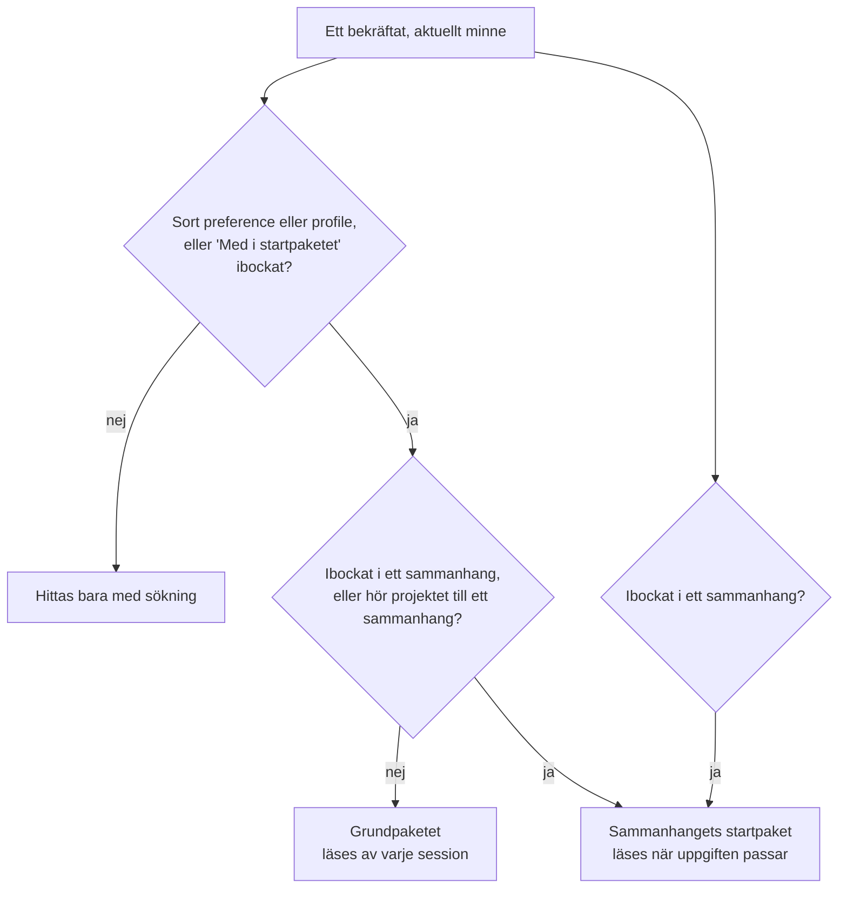
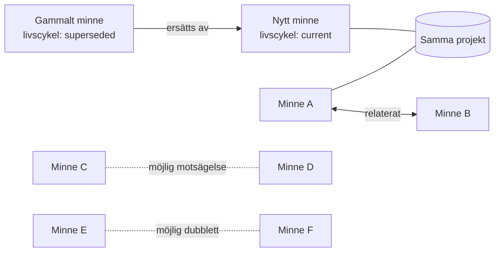

# Begrepp: delarna, fälten och vad som påverkar vad

*[English](concepts.md)*

En guide för den som möter Mimers Brain för första gången. Den förklarar vilka
delarna är, hur de hänger ihop och vad varje fält i minnesredigeraren betyder.
Installationen finns i [install.sv.md](../install.sv.md), hur du ansluter en
klient i [HowToUse.sv.md](../HowToUse.sv.md), och den djupare designen i
[how-it-works.md](how-it-works.md) (engelska).

## I ett stycke

Mimers Brain är en anteckningsbok som språkmodeller läser och skriver i. Varje
anteckning är ett **minne**: en kort text som står på egna ben, plus etiketter
som säger vad den handlar om. En modell ställer en fråga med vanliga ord.
Hjärnan hittar de minnen som *betyder* samma sak, även med andra ord, och
skickar tillbaka dem. Då vet modellen hur dina system ser ut utan att du
förklarar det igen i varje chatt.

## Helheten

| Del | Vad den gör |
| --- | --- |
| **Klient** | Ett program med en språkmodell i: Claude Code, Codex, en chattapp. Den pratar med hjärnan via MCP (eller OpenAPI). |
| **MCP** | *Model Context Protocol.* Standardsättet för en modell att anropa verktyg. Hjärnan erbjuder verktyg som `search_thoughts` och `capture_thought`. |
| **Port / lyssnare** | Hjärnan svarar på tre dörrar. Dörren du använder avgör vad du når. 8790 når allt och ska stanna på hemnätet. 8791 når bara öppna minnen och är den enda internet får se. 8792 är 8791 utan något verktyg som skriver. |
| **Hemlighetsspärr** | Kontrollerar varje text innan något annat ser den. Text som ser ut som ett lösenord, en token eller en nyckel vägras. |
| **Metadatamodell** | En språkmodell som läser ett nytt minne och föreslår titel, sammanfattning, sort, projekt, ämnen, personer och system. |
| **Inbäddningsmodell** | En modell som gör text till en **vektor**: en lång lista tal som beskriver vad texten betyder. Texter med liknande betydelse får liknande vektorer. |
| **Databas** | PostgreSQL med tillägget pgvector. En rad per minne. Den sparar också varje ändring, så varje version kan återställas. |
| **Nattligt underhåll** | En gång per dygn jämför en modell par av liknande minnen och listar de som kanske säger emot varandra eller är nästan kopior. Det ändrar ingenting på egen hand. |
| **Webbgränssnitt** | Sidorna *Minnen*, *Granska*, *Statistik*, *Anslut* och *Inställningar*. Inställningar öppnas bara på port 8790. |

## Vad som händer när ett minne sparas

## Vad som händer när en modell söker

Bara **titel, sammanfattning och text** går in i vektorn. Etiketterna (projekt,
ämnen, personer, system) ändrar **inte** vad en sökning hittar på betydelse. De
är till för filtrering och överblick. Se [Vad som påverkar vad](#vad-som-påverkar-vad).

## Startpaketet (`memory_digest`) och sammanhang

En modell anropar `memory_digest` en gång i början av en session. Den får
användningspolicyn och de minnen den ska känna till innan den gör något. Det är
**startpaketet**.

Ett **sammanhang** är ett startpaket för en sorts arbete, till exempel
*Spectrogon* (jobbet) eller *Personligt*. När en modells uppgift passar ett
sammanhang hämtar den det också. De minnena vinner där de skiljer sig från
grundpaketet. Sammanhang ställs in under **Inställningar → Sammanhang**.

- Bara **bekräftade** minnen kommer med i ett startpaket. Ett minne som en agent
  skrev väntar tills du bekräftar det på sidan *Granska* eller *Minnen*.
- Grundpaketet rymmer högst 15 minnen eller 9 000 tecken; ett sammanhang 10
  minnen eller 6 000 tecken. Sidan *Minnen* säger till när något inte får plats.
  I gruppen *Sammanhang* visar varje sammanhang till exempel `10 / 12`: hur
  många av dess minnen en modell får, av alla minnen i det. 🧭-taggen på ett
  minne säger samma sak: `📌` när det är med i startpaketet, *får inte plats*
  när paketet är fullt och *används inte* när det inte är bekräftat eller
  aktuellt.
- Fäst bara det som en modell skulle göra fel utan, i många olika uppgifter.
  Allt annat hittas med sökning.
- En agent kan inte fästa ett minne eller lägga det i ett sammanhang. Bara du
  kan, eftersom ett startpaket läses som din instruktion.

## Fälten i redigeraren

Redigeraren på sidan *Minnen* visar de här fälten. Taggarna överst är en
sammanfattning av samma fält: sort (🔖, grön), projekt (📁), ämnen (🏷) och
system (⚙). Varje grupp i sidofältet har samma ikon som sina taggar. Datumet är när minnet skrevs; den långa koden under är dess
**GUID**, minnets fasta id.

Exemplet är ett riktigt minne: *"Mimers Brain: rätta titel eller sammandrag på
fel språk med resummarise.mjs"*.

| Fält | Vad det betyder | Vem fyller i | Vad det påverkar |
| --- | --- | --- | --- |
| **Innehåll** | Själva minnet. Ett påstående som går att förstå om flera år, utan chatten runt omkring. Under 1 200 tecken. | Den som skriver | Sökning på betydelse och på ord. Det är det här en modell läser. |
| **Titel** | Ett kort namn, på samma språk som texten. | Metadatamodellen; du kan ändra | Sökning på betydelse, och ordträffar i titeln väger extra. Syns i varje lista. |
| **Sammanfattning** | En eller två meningar. Sökresultat visar den i stället för hela texten. | Metadatamodellen; du kan ändra | Sökning på betydelse och på ord. |
| **Sort** | Vilken sorts kunskap det är. Se tabellen nedan. | Metadatamodellen; du kan ändra | `preference` och `profile` hamnar i startpaketet. `task` har en uppgiftsstatus. `incident` får aldrig en åldersvarning. Filter. |
| **Livscykel** | `current`: gäller nu, sökningen hittar det. `superseded`: ersatt av ett nyare minne, sparas som historik. `archived`: behövs inte längre, sparas, men sökningen hittar det inte. | `current` som standard; `superseded` sätts vid en rättelse | Om sökningen och startpaketet ser minnet alls. |
| **Uppgiftsstatus** | `pending` (återstår) eller `done` (klar). Bara för sorten `task`. | Den som skriver | Filter. Låter en modell hitta det som återstår. |
| **Projekt** | Det **enda** repot eller den tjänst som äger kunskapen. Exempel: `mimers-brain`. Aldrig klienten som skrev det. | Metadatamodellen; du kan ändra och välja bland befintliga projekt under fältet | Filter i sökning och listor. Ett sammanhang kan äga ett projekt: då hamnar projektets stående minnen i sammanhangets startpaket. |
| **Ämnen** | **Flera** breda ämnen, för att bläddra. Exempel: `mimers-brain, backup`. Det finns en fast lista (network, docker, security, home-assistant …); kända synonymer får listans stavning, men vilken text som helst går. | Metadatamodellen; du kan ändra | Bara filter och överblick. |
| **Personer** | Människor minnet handlar om. Bara riktiga personer: ett namn sparas bara om det är en känd person eller står i texten. | Metadatamodellen; du kan ändra | Bara filter. |
| **System** | Namngivna tekniska saker: program, containrar, skript, enheter, konton. Exempel: `Mimers Brain, valv-app, resummarise.mjs, backup.sh`. | Metadatamodellen; du kan ändra | Bara filter. |
| **Verifierat datum** | Dagen någon senast kontrollerade att det fortfarande stämmer. | Du eller en modell | Efter 180 dagar utan kontroll (räknat från det här datumet, annars från när det skrevs) får en modell veta att minnet *kan vara inaktuellt*. |
| **Nivå** | `öppen`: kan läsas även utanför hemnätet. `valv`: bara på LAN, för känslig kontext och `SECRET_REF`-pekare. Aldrig en rå hemlighet i någon av dem. | Den som skriver; du kan flytta på port 8790 | Vilka portar som ser minnet. |
| **Med i startpaketet** | Fäster minnet i startpaketet. Preferenser och profiler är med som standard; bocka ur för att ta bort dem. | Bara du | Om varje session läser det först. |
| **Sammanhang** | Bockar in minnet i ett eller flera sammanhangs startpaket i stället för grundpaketet. | Bara du | Vilket startpaket det hamnar i. |
| **Media** | Länkar till en person, ett album eller en bild i Immich, eller till en webbsida. Hjärnan sparar bara länken. | Du | En modell kan hämta bilderna med `get_media`. Kortet visar miniatyrer. |

Några fält syns inte i redigeraren men styr hur mycket ett minne litas på:
**granskningsstatus** (väntar, bekräftad, bara underlag, inaktuell, avvisad),
**ursprung** (användare, agent, import …) och **skrivet av** (vilken klient som
skrev det). Granskningsstatus sätter du på sidan *Granska* eller på kortet.

### Sorter

| Sort | Använd för |
| --- | --- |
| `fact` | Något som är sant om hur något är. |
| `reference` | Var något finns: en sökväg, en adress, en länk. |
| `procedure` | Hur man gör något, steg för steg. |
| `decision` | Ett val som har gjorts, och varför. |
| `lesson` | Något man har lärt sig, så att misstaget inte görs igen. |
| `incident` | Vad som hände när något gick sönder, och slutsatsen. |
| `task` | Något som återstår att göra, med ett konkret nästa steg. |
| `idea` | En möjlig framtida ändring. Inte beslutad. |
| `preference` | Hur användaren vill ha saker gjorda. I startpaketet. |
| `profile` | Fakta om användaren som person. I startpaketet. |

### Projekt, ämnen, system och personer: skillnaden

De svarar på fyra olika frågor:

| Fält | Fråga | Hur många | Exempel |
| --- | --- | --- | --- |
| **Projekt** | *Vems kunskap är det här?* | Ett | `mimers-brain` |
| **Ämnen** | *Vad handlar det om, i stort?* | Några | `mimers-brain`, `backup` |
| **System** | *Vilka namngivna saker nämns?* | Hur många som helst | `valv-app`, `resummarise.mjs`, `backup.sh` |
| **Personer** | *Vilka människor handlar det om?* | Hur många som helst | `Erik` |

En bra tumregel: **projekt** är mappen minnet skulle ligga i; **ämnen** är
hyllans etiketter; **system** är sakerna du kan peka på; **personer** är bara
människor. Samma namn kan betyda olika saker: *Snille* under personer är en
person, under system är det ett GitHub-konto.

## Hur minnen hänger ihop med varandra

Minnen står inte bara ensamma. Hjärnan länkar dem:

- **Ersätter.** En rättelse (`supersede_thought`) skriver ett nytt minne och
  markerar det gamla som ersatt. Det gamla finns kvar som historik och pekar på
  sin ersättare. Fästning och media flyttar till det nya.
- **Relaterat.** När du bestämmer att två nästan-kopior båda ska finnas kvar kan
  du länka dem som relaterade.
- **Möjlig motsägelse.** Kontrollen varje natt listar par av liknande minnen som
  kanske säger motsatta saker. Du avgör på sidan *Granska*: avfärda, eller rätta
  det felaktiga med en ersättning.
- **Möjlig dubblett.** Par med nästan samma text. Du behåller båda, länkar dem
  eller slår ihop dem.
- **Samma projekt / ämne / system.** Inte en länk i sig, men filtren på sidan
  *Minnen* visar alla minnen som delar etiketten.

## Vad som påverkar vad

| När du ändrar … | … händer det här |
| --- | --- |
| Innehåll, titel eller sammanfattning | Minnet får en ny vektor, så sökning på betydelse ändras. Ändringsloggen sparar den gamla versionen. |
| Projekt, ämnen, personer eller system | Filtren ändras. Sökning på betydelse ändras **inte**. Ett nytt projekt kan flytta minnet in i eller ut ur ett sammanhang. |
| Sort till `preference` eller `profile` | Det kommer med i startpaketet (när det är bekräftat), om du inte bockar ur *Med i startpaketet*. |
| Livscykel till `archived` | Sökningen och startpaketet slutar se det. Det finns kvar. |
| Nivå till `valv` | Port 8791 och 8792, och varje molnchatt, slutar se det. |
| Nivå till `öppen` | Det blir läsbart utanför hemnätet. Redigeraren frågar först. |
| Verifierat datum | Nollställer åldersvarningen på 180 dagar. |
| Granskningsstatus till bekräftad | Det rangordnas lite högre, kan läsas som en instruktion och kan komma med i ett startpaket. |
| Inbäddningsmodellen (Inställningar) | Varje minne får en ny vektor i bakgrunden. Sökgränserna hör till modellen, så de byts med den. |
| Ett sammanhangs projekt (Inställningar) | Stående minnen i de projekten flyttar från grundpaketet till sammanhanget. |

## Ord som används i hjärnan

| Ord | Betydelse |
| --- | --- |
| **Minne** (*thought* i verktygsnamnen) | En sparad text med sina etiketter. |
| **Vektor / inbäddning** | Tal som beskriver vad en text betyder. Närliggande vektorer betyder liknande innehåll. |
| **Likhet** | Hur nära två vektorer är, från 0 till 1. Visas i procent i sökresultat. |
| **Gräns** | Den lägsta likhet som räknas. Det finns fyra: sökning, recall-hook, motsägelse och dubblett. Varje inbäddningsmodell har sina egna. |
| **Nivå** | Öppen eller valv. Avgörs av porten, aldrig av vad klienten säger. |
| **Valvet** | Den del av hjärnan som bara hemnätet når. |
| **`SECRET_REF`** | En pekare som säger *var* en hemlighet finns, aldrig själva hemligheten. |
| **Startpaket / digest** | Det en modell läser en gång i början av en session. |
| **Sammanhang** | Ett startpaket för en sorts arbete. |
| **Kvitto / trace** | Efter en sökning rapporterar modellen vilka träffar den använde. Bara id sparas, aldrig frågan. |
| **Agent** | En modell som skriver på egen hand. Dess minnen väntar på din granskning. |
| **Recall-hook** | Ett tillägg till Claude Code som söker i hjärnan vid varje fråga och lägger till upp till tre tydliga träffar. Se [tools/hooks](../tools/hooks/README.md). |
| **Ingest** | Att dela upp en lång text i korta minnen som du godkänner ett i taget. |
